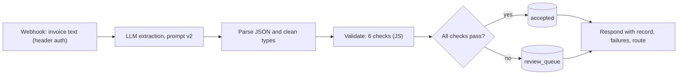
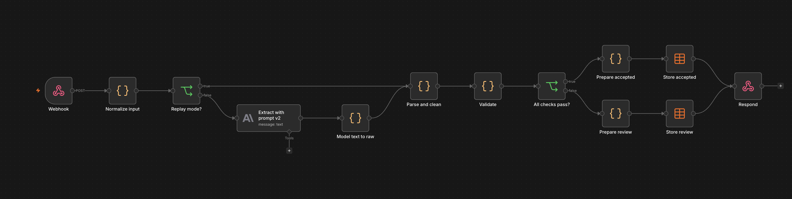
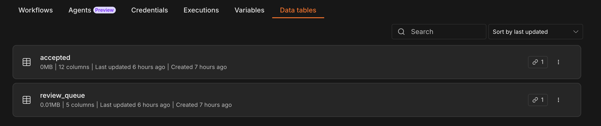

# Invoice Intake Workflow in n8n (Simulated Scenario)

> Learning project, built with the help of an AI assistant (Claude).

An n8n workflow that takes invoice text, extracts nine fields with an LLM,
validates them with deterministic checks and routes the invoice to
`accepted` or to a `review_queue`. It reuses the frozen prompt v2 and the
validation rules from
[invoice-extraction-simulation](../invoice-extraction-simulation).
**Simulated scenario with synthetic data.**

## Architecture

## Success criteria (fixed before building)
1. **Parity test:** for all 60 stored v2 predictions of the development
   set, the n8n workflow returns the same record, the same list of failed
   checks (same order) and the same route as the Python implementation
   (`extract.py` + `validators.py`). Required: 60/60 identical. A
   supplementary set of 15 hand-made edge cases (one per kind of failure)
   is compared the same way and reported separately.
2. **End-to-end run:** 20 development invoices selected by a fixed rule
   (all 13 invoices whose expected route is `review`, plus the first 7
   whose expected route is `auto`, in file order) go through the whole
   workflow with the live model. Reported: route accuracy, invoice
   accuracy (all nine fields), silent errors, rows written to each table.
   This is a smoke test of the integration, not a model evaluation: the
   development set was already used to design prompt v2, and the earlier
   test set is used up.
3. The exported workflow contains no credentials, and the production
   webhook is protected.
   The test-mode and production webhooks require a secret header.

## Status
Complete. Error logging was dropped (see Limitations).

## What it does
- Receives an invoice as text through a webhook protected by a secret header.
- Extracts nine fields with Claude Haiku 4.5 (frozen prompt v2).
- Validates the result with six deterministic checks (JavaScript port of
  `validators.py`) and writes the invoice to the `accepted` table or to the
  `review_queue` table.
- Replay mode: a request can carry a stored model response
  (`raw_response`) instead of invoice text. The model is skipped, which
  makes the validation logic testable without API calls.
- Empty requests are rejected with an error.

## Results

| Test | Result |
|---|---|
| Parity with the Python implementation (60 stored v2 predictions of the development set + 15 hand-made edge cases) | 75/75 identical (record, list of failed checks, route) |
| End-to-end run, 20 development invoices through the live workflow with the model | route accuracy 20/20, all nine fields correct 20/20, 0 silent errors; 7 rows in `accepted`, 13 in `review_queue` |

Raw outputs: `tests/parity_result.txt`, `tests/e2e_result.txt`.

## Findings
- **Port fidelity:** the JavaScript validation matches the Python one on all
  75 compared cases, including cases that never occurred in the data
  (a `23%` string as VAT rate, a date outside the allowed range, a reply
  without JSON).
- **Integration works end to end:** 20/20 invoices were routed as expected
  and the rows written to the two tables match the routes.
- **This is a smoke test, not a model evaluation.** The end-to-end sample
  contains all 13 development invoices with an injected error or a missing
  field plus 7 clean ones, chosen by a rule fixed before the run. It
  includes the two invoices on which prompt v1 failed in the earlier
  project, but prompt v2 was written after seeing those errors, so passing
  them is not independent evidence. The model is not deterministic; the
  first run is reported.

## Repository
| Path | Purpose |
|---|---|
| `workflow/invoice_intake.json` | Exported workflow (no credentials) |
| `prompt_v2.txt` | Frozen prompt, copied from the extraction project |
| `tests/send.py` | Sends one invoice to the webhook |
| `tests/parity.py` | Parity test against the Python implementation |
| `tests/e2e.py` | End-to-end run on 20 development invoices |

The tests import code from
[invoice-extraction-simulation](../invoice-extraction-simulation).

## How to run
1. Import `workflow/invoice_intake.json` into n8n.
2. Create credentials: Anthropic API key, and a Header Auth credential
   (name `X-Api-Key`, value any long random string).
3. Create two data tables with text columns only:
   `accepted` (`invoice_id`, `invoice_number`, `issue_date`,
   `seller_name`, `seller_nip`, `buyer_nip`, `net_amount`, `vat_rate`,
   `vat_amount`, `gross_amount`, `processed_at`) and `review_queue`
   (`invoice_id`, `failures`, `record_json`, `processed_at`).
4. Select the tables in the two Data table nodes and publish the workflow.
5. Copy `.env.example` to `.env` (in the repository root) and fill it in.
6. Run `python3 tests/parity.py` and `python3 tests/e2e.py`.

Unpublish the workflow when not testing: it calls a paid model.

## Limitations
- Synthetic plain-text invoices only; no scans, OCR or PDF input.
- Parity covers the validation code, not the model. The 75 cases are
  few; the JavaScript port computes amounts in cents, the Python one uses
  decimals, and rare rounding differences cannot be excluded.
- The end-to-end sample is small (20) and comes from the development set.
- No error logging: failed executions are visible only in the n8n
  execution list. An error workflow was started but its firing was not
  verified, so it was removed.
- The webhook is protected by a static header key; there is no rate
  limiting.
- Data tables are meant for light use and have a storage limit.

## Next steps
- Verified error logging (error workflow that is shown to fire).
- A check that each extracted value occurs in the source text (see the
  extraction project).
- Pilot on a few anonymised real invoices with a business partner.