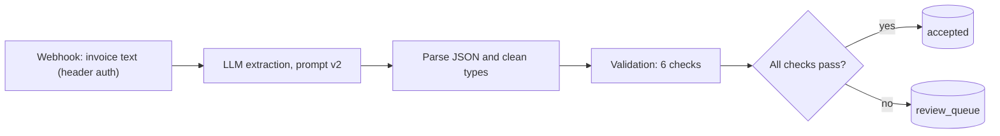

# Invoice Intake Workflow in n8n (Simulated Scenario)

> Learning project, built with the help of an AI assistant (Claude).

An n8n workflow that takes invoice text, extracts nine fields with an LLM,
validates them with deterministic checks and routes the invoice to
`accepted` or to a `review_queue`. It reuses the frozen prompt v2 and the
validation rules from
[invoice-extraction-simulation](../invoice-extraction-simulation).
**Simulated scenario with synthetic data.**

## Architecture

## Success criteria (fixed before building)
1. **Parity test:** for all 60 stored v2 predictions of the development
   set, the n8n workflow returns the same record, the same list of failed
   checks (same order) and the same route as the Python implementation
   (`extract.py` + `validators.py`). Required: 60/60 identical. A
   supplementary set of 15 hand-made edge cases (one per kind of failure)
   is compared the same way and reported separately.
2. **End-to-end run:** 20 development invoices selected by a fixed rule
   (all 13 invoices whose expected route is `review`, plus the first 7
   whose expected route is `auto`, in file order) go through the whole
   workflow with the live model. Reported: route accuracy, invoice
   accuracy (all nine fields), silent errors, rows written to each table.
   This is a smoke test of the integration, not a model evaluation: the
   development set was already used to design prompt v2, and the earlier
   test set is used up.
3. The exported workflow contains no credentials, and the production
   webhook is protected.
   The test-mode and production webhooks require a secret header.

## Status
In progress.

## Results
To be measured.